# Awesome-Elastic-Data-Warehouse-Compute

  

  
  
  
  
  
  

---

## 🚀 Overview & Architecture

> **A curated, comprehensive landscape of Elastic Data Warehouse Compute platforms, Distributed SQL query engines, and Cloud-Native OLAP architectures.** 🌟 *Star the repo if you find it helpful!* 🌟

Modern analytical architectures have decisively evolved beyond rigid monolithic databases into **elastic, decoupled systems**. By separating storage from compute, organizations can scale processing power on-demand, execute high-concurrency analytical queries, isolate independent business workloads, and reduce infrastructure spend by paying only for active query execution.

This directory tracks the foremost **SaaS managed data warehouse solutions** (featuring autoscaling, per-second billing, and serverless clusters) and **Open-Source distributed query engines & analytical DBMS** (production-proven on Kubernetes and cloud object stores like Amazon S3, Google Cloud Storage, and Apache Iceberg/Delta Lake).

---

## 📑 Table of Contents

- [📊 Sector Overview & Market Dynamics](#-sector-overview--market-dynamics)
- [☁️ SaaS & Hosted Elastic Platforms](#️-saas--hosted-elastic-platforms)
- [🔓 Open-Source GitHub Projects](#-open-source-github-projects)
- [📈 Star History](#-star-history)
- [🤝 How to Contribute](#-how-to-contribute)
- [💖 Support & Sponsorship](#-support--sponsorship)
- [⚖️ Disclaimer](#️-disclaimer)

---

## 📊 Sector Overview & Market Dynamics

The global cloud data warehousing and analytical compute market was estimated at approximately **$7.5B–$13.3B (2024–2025)** and is projected to expand at a **CAGR of 22%–26%**, driven by enterprise-wide migrations from legacy on-premise appliances to elastic, decoupled lakehouse architectures. 

The sector exhibits an **oligopolistic, highly concentrated structure** at the top: major hyperscalers (**AWS Redshift**, **Google Cloud BigQuery**, **Microsoft Fabric**) and specialized independent giants (**Snowflake**, **Databricks**) capture roughly **68%+ of aggregate industry revenue**. Concurrently, the landscape remains **vibrantly fragmented** across an active ecosystem of specialized high-performance OLAP engines (**ClickHouse**, **Firebolt**) and open federated query acceleration engines (**Trino**, **Dremio**, **StarRocks**), delivering specialized price-performance trade-offs for high-throughput, real-time analytics.

---

## ☁️ SaaS & Hosted Elastic Platforms

A detailed price-performance comparison of commercial and hosted elastic compute engines. Platforms are sorted descending by company scale (market capitalization / valuation):

| Platform | Company Valuation / Revenue | Starting Tier Pricing | Free Tier / Trial Limits | Description |
| :--- | :--- | :--- | :--- | :--- |
| **Amazon Redshift Concurrency Scaling** | ~$2.48T Market Cap (Amazon) / ~$600B+ Rev | **$0.543/hour** (billed per second matching primary node rates, e.g., `ra3.large` on-demand; Serverless from **$0.375/RPU-hour** / $1.50/hr minimum 4-RPU base) | **1 hour free scaling/day per active cluster** (accumulates up to 30 hours); Redshift Serverless offers **90-day trial with $300 credits** (or 2-month 750 hrs/month `dc2.large` provisioned trial) | Automatic compute scaling for concurrent queries with decoupled compute isolation. |
| **Google BigQuery Slots** | ~$2.32T Market Cap (Alphabet) / ~$350B+ Rev | **$0.04/slot-hour** (Standard Edition, US multiregion, autoscale baselines) or **$6.25 per TB** scanned on on-demand | **1 TB of query data processed per month forever free**; Google Cloud free trial grants **$300 credits for 90 days** | Autoscaling query compute units with decoupled storage-compute isolation and commitment discounts. |
| **Databricks SQL Serverless** | ~$134B Valuation / ~$4.8B+ ARR (Dec 2025) | **$0.70/DBU** (Serverless SQL Compute, inclusive of cloud infrastructure costs; 2X-Small warehouse consumes ~1 DBU/hr) | **14-day free trial with up to $400 in usage credits** (plus forever-free restricted Databricks Free Edition for personal non-commercial learning) | Fully managed elastic lakehouse SQL engine on serverless infrastructure with near-instant spin-up. |
| **Snowflake Virtual Warehouses** | ~$75B Market Cap / ~$3.63B Rev (FY2025) | **$2.00/credit** (Standard Edition AWS US East, billed per second with 60s minimum; X-Small = 1 credit/hour = **$2.00/hour**) | **30-day free trial with $400 usage credits** (no credit card required for standard signup) | Independent virtual warehouse clusters with strict workload isolation and per-second autosuspension/resumption. |
| **Starburst Galaxy Clusters** | ~$3.35B Valuation / ~$100M+ ARR | **$0.50/credit** (Pro Tier; cluster costs scale per credit hour based on coordinator/worker sizing) | **3 clusters forever free**; includes **30-day free trial with $500 usage credits** (access to Warp Speed and fault-tolerant execution) | Fully managed, production-grade Trino clusters with autoscaling and cross-cloud federated query capability. |
| **ClickHouse Cloud Clusters** | ~$2.00B Valuation (Series B) / VC-backed | **$0.2181/compute unit/hour** (Basic tier; 1 Compute Unit = 2 vCPU + 8 GiB RAM, billed per minute; ~$0.22/hour) | **30-day free trial with $300 usage credits** (no forever-free tier; automatically lapses unless converted to paid) | Serverless ClickHouse deployment with shared-nothing speed, scale-to-zero compute, and decoupled cloud object storage. |
| **Dremio Engines** | ~$2.00B Valuation (Series E) / VC-backed | **$0.20/DCU-hour** (Dremio Cloud pay-as-you-go; Extra Small engine consumes 32 DCUs/hr = **$6.40/hour**) | **30-day free trial with $400 usage credits** on Dremio Cloud (plus forever-free Community Edition for self-managed Kubernetes/Docker) | Apache Iceberg-native query engines for lakehouse analytics with engine auto-start/stop and replica scaling. |
| **Firebolt Engines** | ~$1.40B Valuation (Series C) / VC-backed | **$0.92/hour** (Small compute-optimized engine running 4 FBUs/hr; compute billed per second, pass-through S3 storage) | **30-day free trial with $200 usage credits** (scale-to-zero compute supported on trial) | Sub-second real-time analytics data warehouse with isolated multi-engine compute and scale-to-zero pricing. |

---

## 🔓 Open-Source GitHub Projects

Self-hosted, distributed MPP and columnar engines capable of elastic scaling when orchestrated with Kubernetes, container auto-scalers, or cloud instance groups.

> **Sorted descending by GitHub Star Count** ⭐ (Badges link directly to stargazers):

### 1. [ClickHouse](https://github.com/ClickHouse/ClickHouse) 
- **Description**: Column-oriented database management system for real-time analytical reporting (OLAP). Scales horizontally with shared-nothing or decoupled cloud-native architectures.
- **Key Features**: Vectorized execution, MergeTree storage engine family, replication and sharding, multi-node scaling on Kubernetes via ClickHouse Operator.
- **Tech Stack**: C++ (Apache-2.0 License).
- **Elasticity Profile**: Worker pods scale horizontally across node pools; ClickHouse Cloud provides true compute-storage separation.

### 2. [DuckDB](https://github.com/duckdb/duckdb) 
- **Description**: High-performance in-process analytical SQL database management system. Often referred to as the "SQLite for Analytics", running serverlessly in ephemeral compute containers or Lambdas.
- **Key Features**: Zero external dependencies, vectorized columnar query execution engine, native Parquet/Arrow/CSV streaming, direct querying over S3 object stores.
- **Tech Stack**: C++ (MIT License).
- **Elasticity Profile**: Employs an ultra-lightweight footprint suitable for scale-to-zero serverless lambdas and ephemeral batch workers.

### 3. [Presto](https://github.com/prestodb/presto) 
- **Description**: Distributed SQL query engine designed for running interactive analytical queries against data sources of all sizes ranging from gigabytes to petabytes.
- **Key Features**: ANSI SQL compliance, connector architecture (Hive, Iceberg, Hudi, Cassandra, Kafka), multi-tenant coordinator-worker model, native Presto C++ (Velox) integration.
- **Tech Stack**: Java, C++ (Apache-2.0 License / Linux Foundation).
- **Elasticity Profile**: Worker pools scale elastically on Amazon EMR, Kubernetes, or self-hosted autoscaling clusters.

### 4. [Trino](https://github.com/trinodb/trino) 
- **Description**: Fast distributed SQL query engine for big data analytics that queries data where it lives without data movement (formerly PrestoSQL).
- **Key Features**: High-performance federated querying across object stores (S3, GCS, Azure Blob, MinIO), lakehouses (Iceberg, Delta Lake, Hudi), and RDBMS engines; native dynamic autoscaling on Kubernetes.
- **Tech Stack**: Java (Apache-2.0 License).
- **Elasticity Profile**: Decoupled compute cluster with horizontal autoscaling worker nodes, spot instance resilience, and Starburst Galaxy managed enterprise options.

### 5. [Apache Druid](https://github.com/apache/druid) 
- **Description**: High-performance, real-time analytics database designed for fast streaming ingestion and sub-second ad-hoc OLAP queries on event-driven data.
- **Key Features**: Multi-stage distributed architecture separating MiddleManager (ingestion), Historical (storage/caching), and Broker (query parsing/fan-out) processes; deep storage decoupling on S3/HDFS.
- **Tech Stack**: Java (Apache-2.0 License).
- **Elasticity Profile**: Historical and MiddleManager tiers scale independently and elastically depending on ingestion pressure and query concurrency.

### 6. [Apache Doris](https://github.com/apache/doris) 
- **Description**: Easy-to-use, high-performance MPP analytical database for real-time reporting, ad-hoc analysis, and unified lakehouse queries.
- **Key Features**: Fully decoupled storage-and-compute architecture (Compute Nodes / Storage Engine), ANSI SQL compliance, sub-second latency for 10,000+ QPS, native MySQL wire protocol support.
- **Tech Stack**: C++, Java (Apache-2.0 License).
- **Elasticity Profile**: Stateless Compute Nodes (CN) scale up and down dynamically without data migration, reading persistent shared data directly from object stores.

### 7. [StarRocks](https://github.com/StarRocks/starrocks) 
- **Description**: Next-generation sub-second MPP database system built for multi-table join acceleration and lakehouse query analytics.
- **Key Features**: Shared-data architecture, decoupled compute nodes (CN) with local NVMe caching, Multi-Catalog support for Apache Iceberg / Apache Hudi / Delta Lake, asynchronous materialized views.
- **Tech Stack**: C++, Java (Apache-2.0 License / Linux Foundation).
- **Elasticity Profile**: Elastic Compute Nodes can be spun up or scaled down in seconds based on query demand without storage reshuffling.

### 8. [Apache DataFusion](https://github.com/apache/datafusion) 
- **Description**: Extensible, blazingly fast distributed SQL query engine and computing toolkit written in Rust, powered by Apache Arrow.
- **Key Features**: Modular vectorized execution engine, native SIMD operations, memory safety without garbage collection pauses, foundational engine for modern distributed query stacks.
- **Tech Stack**: Rust (Apache-2.0 License).
- **Elasticity Profile**: Extremely light CPU and memory overhead; spins up instantly in ephemeral serverless workloads and containerized micro-engines.

### 9. [Velox](https://github.com/facebookincubator/velox) 
- **Description**: High-performance C++ vectorized database acceleration library designed to unify and accelerate execution engines including Presto C++ and Apache Spark (Gluten).
- **Key Features**: Arrow-compatible in-memory columnar processing, vectorized expression evaluation, optimized memory pooling, reusable composable execution pipeline.
- **Tech Stack**: C++ (Apache-2.0 License).
- **Elasticity Profile**: Embeddable acceleration layer that inherits the dynamic scaling elasticity of the hosting distributed framework.

### 10. [Apache Pinot](https://github.com/apache/pinot) 
- **Description**: Real-time distributed OLAP datastore purpose-built to execute low-latency analytical queries at ultra-high concurrency (e.g., LinkedIn and Uber user-facing analytics).
- **Key Features**: Columnar storage with pluggable indices (Star-Tree, inverted, range), real-time stream ingestion from Kafka/Kinesis, distributed broker-server architecture.
- **Tech Stack**: Java (Apache-2.0 License).
- **Elasticity Profile**: Segment store decoupled from query brokers; scales dynamically on Kubernetes to handle peak concurrency spikes.

---

## 📈 Star History

---

## 🤝 How to Contribute

Contributions are warmly welcomed! Help keep this awesome repository up-to-date and comprehensive:

1. 🍴 **Fork the repository** on GitHub.
2. 🌿 **Create a new branch** (`git checkout -b feature/new-engine-addition`).
3. 📝 **Add or update an entry** in `README.md`:
   - Follow the established formatting conventions (include name, category, GitHub link, star count badge, starting price, free tier limit, and elasticity profile).
   - Ensure descriptions are strictly factual and concise.
4. 🚀 **Submit a Pull Request** with a brief summary of the addition or update.

---

## 💖 Support & Sponsorship

If you find **Awesome-Elastic-Data-Warehouse-Compute** valuable for your data engineering team, architectural benchmarking, or research:

- ⭐ **Star this repository** to show your appreciation!
- 🍴 **Fork and share** with colleagues and data engineering communities.
- ☕ **Buy me a coffee & support ongoing maintenance:** Visit the [Sponsor Dashboard](https://github.com/sponsors/ishandutta2007).

Your sponsorship helps keep this catalog verified, active, and regularly updated with the latest industry pricing and engine releases!

---

## ⚖️ Disclaimer

- This is a **community-curated** list — non-exhaustive, educational, and not an endorsement of specific commercial vendors.
- **Enterprise Security & Compliance:** Data warehouse clusters processing enterprise analytics must comply with relevant privacy regulations (GDPR, HIPAA, CCPA) and enforce RBAC/credential boundaries.
- **Architectural Trade-offs**:
  - **Snowflake Virtual Warehouses:** Complete workload isolation with per-second billing; beware oversizing risks (an X-Large costs 4× a Medium).
  - **Amazon Redshift Concurrency Scaling:** 1 free hour/day per cluster handles query spikes for ~97% of workloads; sustained spikes trigger on-demand overages.
  - **Google BigQuery Slots:** Serverless autoscaling with fixed slot commitments; break-even is typically above 50 slots compared to on-demand data scanning.
  - **Databricks SQL Serverless:** Fully managed lakehouse compute with rapid spin-up; DBU consumption tracks query complexity.
  - **Open-Source Engines (ClickHouse, Trino, Doris, StarRocks):** True elasticity is achieved via orchestration (Kubernetes HPA, node autoscalers, cloud instance groups). Choose open-source when self-hosting and direct control over infrastructure is paramount.

---

  <b>Built for Data Engineers, Lakehouse Architects, and Infrastructure Teams worldwide.</b> 
  Let's build more transparent, elastic, and cost-effective data warehousing systems.

